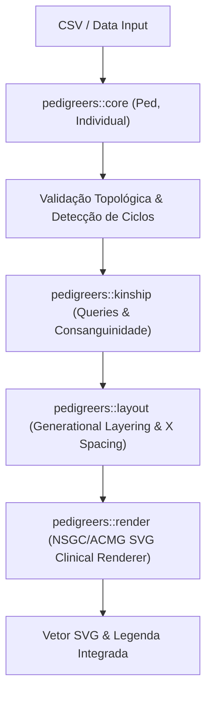

# Especificação Técnica: Paridade Funcional do Núcleo do pedtools em Rust

- **Ticket:** #1
- **Branch:** `feat/1-pedtools-parity-core`
- **Norma:** GOST DD-TDD v1.1.0
- **Status:** Planejado

---

## 1. Visão Geral & Escopo

Esta especificação define a implementação em Rust da crate **`pedigreers`**, estabelecendo paridade funcional estrita com o núcleo do pacote **`pedtools`** do ecossistema R (desenvolvido por Magnus Dehli Vigeland / Universidade de Oslo), eliminando a dependência do runtime GNU R e fornecendo uma API de alta performance para modelagem e renderização de heredogramas clínicos.

---

## 2. Arquitetura de Módulos

### 2.1 Módulo `core`
* **`Individual`**:
  * `id`: Identificador único (`String`).
  * `fid`: ID do pai (`Option<String>`).
  * `mid`: ID da mãe (`Option<String>`).
  * `sex`: Enum `Sex { Unknown = 0, Male = 1, Female = 2 }`.
  * `status`: Enum `Status { Alive = 0, Deceased = 1 }`.
  * `proband`: Booleano indicando probando.
  * `affected`: Inteiro de status de afecção (0 = sadio, 1 = afetado pleno, 2 = quadrantes).
  * `carrier`: Booleano indicando portador heterozigoto assintomático.
  * `suspect`: Booleano para status sob investigação.
* **`Ped`**:
  * Armazenamento baseado em mapa e ordem determinística (`HashMap<String, Individual>` + `Vec<String>`).
  * Validações de integridade biológica: ausência de loops acíclicos (indivíduo pai de si mesmo).
  * Leitor universal de CSV com normalização de sinônimos (`pai`/`fid`, `mae`/`mid`, `sexo`/`sex`, etc.).

### 2.2 Módulo `kinship`
* Consultas diretas:
  * `parents(id)` -> `(Option<String>, Option<String>)`
  * `children(id)` -> `Vec<String>`
  * `spouses(id)` -> `Vec<String>`
  * `siblings(id)` -> `Vec<String>`
  * `ancestors(id)` -> `HashSet<String>`
* **Detecção de Consanguinidade**:
  * Uma união entre `A` e `B` é consanguínea se `ancestors(A) ∩ ancestors(B) ≠ ∅`.

### 2.3 Módulo `layout`
* **Camadas de Gerações ($Y$)**:
  * Fundadores atribuídos à Geração 1.
  * Filhos atribuídos à geração `max(gen(pai), gen(mae)) + 1`.
  * Cônjuges alinhados na mesma camada horizontal.
* **Posicionamento Horizontal ($X$)**:
  * Agrupamento de núcleos familiares (parceiros adjacentes com separação `dx_spouse`).
  * Centro de união $X_{union} = \frac{x_A + x_B}{2}$.
  * Distribuição equilibrada de irmãos sob a barra de união horizontal.

### 2.4 Módulo `render` (Conformidade NSGC / ACMG)
* **Símbolos Clínicos**:
  * Homem: Quadrado de $28 \times 28$ px.
  * Mulher: Círculo de raio 14 px.
  * Sexo Indefinido: Losango.
* **Adornos Clínicos**:
  * Probando: Seta direcionada a 45° no canto inferior esquerdo com a letra 'P'.
  * Falecido: Linha diagonal cortando o símbolo.
  * Afetado: Preenchimento total com `#000000` ou subdivisão em quadrantes.
  * Portador: Ponto circular sólido central.
  * Suspeito: Ponto de interrogação '?' centralizado.
  * Casamento Consanguíneo: Linha dupla de união matrimonial horizontal.
* **Card de Legenda**: Card estético no rodapé com os símbolos utilizados no heredograma.

---

## 3. Plano de Testes (TDD)

1. **Teste 1: Família Nuclear Simples:** Pais (1=Masculino, 2=Feminino) e 2 filhos (3=Homem, 4=Mulher).
2. **Teste 2: Casamento Consanguíneo:** Pais que compartilham avós comuns gerando linha de casamento dupla.
3. **Teste 3: Símbolos Clínicos NSGC:** Probando, falecido, portador e afetado com exportação SVG válida.
4. **Teste 4: Parse de CSV com Colunas em Português e Inglês:** Paridade estrita com as planilhas do Joaju.
